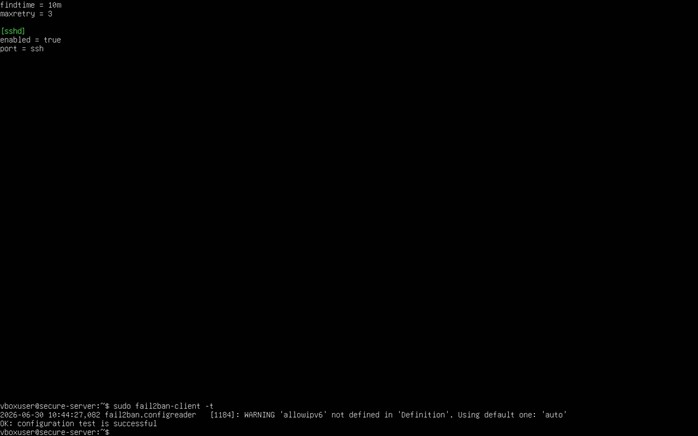
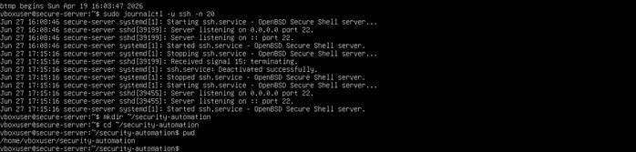
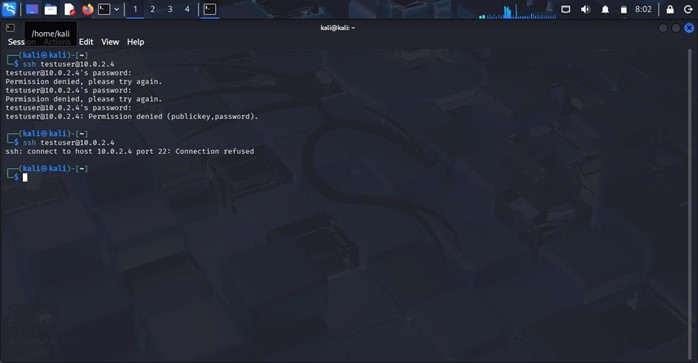
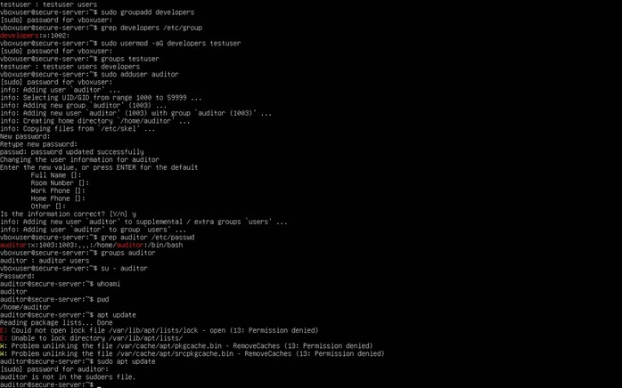

# Secured Linux Server Environment

## Project Overview

This project focused on designing and implementing a secured Linux server environment using virtualization technology and automated security controls.

The environment was built in a controlled virtual lab using Ubuntu Server as the system being secured and Kali Linux as the testing machine. The project explored practical methods for strengthening server security, controlling access, monitoring system activity, and automating security checks.

## Objectives

- Strengthen Linux server security.
- Implement user and group access controls.
- Secure remote access using SSH.
- Configure a firewall to control network traffic.
- Introduce tools for intrusion prevention and security auditing.
- Automate routine security checks using Bash scripting and Cron.

## Technologies and Tools

- **Ubuntu Server 24.04 LTS** — server environment
- **Kali Linux** — security testing environment
- **Oracle VirtualBox** — virtualization
- **OpenSSH Server** — remote administration
- **UFW** — firewall management
- **Fail2Ban** — protection against repeated suspicious authentication attempts
- **Lynis** — Linux security auditing
- **Bash** — scripting and automation
- **Cron** — scheduled task execution

## Security Controls Implemented

### 1. User and Access Management

Configured user and group accounts, file permissions, and role-based access controls to help restrict access to system resources.

### 2. SSH Security

Configured SSH for remote server administration as part of the server-hardening process.

### 3. Firewall Configuration

Used UFW to manage firewall rules and control permitted network traffic.

### 4. Intrusion Prevention

Integrated Fail2Ban to help protect against repeated failed authentication attempts.

### 5. Security Auditing

Used Lynis to assess the Linux system's security configuration and identify areas for improvement.

### 6. Automated Security Checks

Developed a Bash script named `security_check.sh` to collect security-related system information and generate reports. Cron was used to schedule routine execution.

## Lab Environment

The project used a virtualized environment containing:

- Ubuntu Server as the secured server.
- Kali Linux as the security testing client.
- A virtual network for communication between the systems.

Testing was conducted in a controlled lab environment.

## Implementation Evidence

The following screenshots provide visual evidence of selected configurations and testing activities from the project.

### 1. Fail2Ban Configuration

### 2. Fail2Ban Verification

### 3. Security Automation

### 4. SSH Security Testing

### 5. UFW Firewall Configuration

## Project Scope

This was an academic virtualization-based security project. It did not involve deploying the environment to AWS, Microsoft Azure, or Google Cloud.

The project provides a foundation for further work in Linux security, cloud infrastructure security, and security automation.

## Future Improvements

- Recreate and publish the implementation scripts and configuration documentation.
- Expand security monitoring and log analysis.
- Rebuild the lab and explore equivalent security controls in AWS.
- Develop infrastructure-as-code and automated security testing skills.

## Skills Demonstrated

Linux Administration · Server Hardening · Access Control · SSH · Firewall Management · Security Auditing · Bash Scripting · Task Scheduling · Virtualization · Security Testing

---

**Project type:** Academic cybersecurity project  
**Environment:** Local virtualized lab  
**Focus:** Linux security and automated security controls
